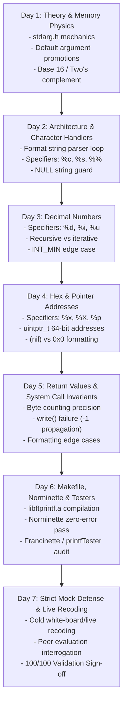

# 7-Day ft_printf Mastery & Validation Blueprint

## Objective
- 100% Code completion (Written entirely by `aait-lac`, 0 lines of AI autocomplete).
- Full theoretical mastery of calling conventions, variadic macros, and number systems.
- Live recoding & peer-defense readiness.
- 100/100 score on strict mock evaluation & official testers.

---

## The 7-Day Sprint Schedule

---

## Detailed Daily Breakdown

### **Day 1: The Foundations & Theory Defense**
- **Theory to Master**:
  - `va_list`, `va_start`, `va_arg`, `va_end`.
  - Default argument promotions (`char`/`short` -> `int`, `float` -> `double`).
  - System V AMD64 ABI: Registers (`rdi`, `rsi`, `rdx`, `rcx`, `r8`, `r9`) vs Stack.
  - Number representation: Two's complement and hexadecimal bases.
- **Milestone Check**: Pass oral theory defense with 0 hesitation.

### **Day 2: Core Engine & Basic Output (`%c`, `%s`, `%%`)**
- **Implementation**:
  - Directory layout: `srcs/`, `includes/ft_printf.h`.
  - Main parser loop: traversing `const char *format`.
  - Dispatch mechanism: identifying `%` and calling conversion functions.
  - Handlers:
    - `%c` (handling `\0`).
    - `%s` (handling `(null)`).
    - `%%` (literal percent).
- **Milestone Check**: Test `ft_printf("Hello %s %c %%\n", "world", '!');` against standard `printf`.

### **Day 3: Decimal & Unsigned Numbers (`%d`, `%i`, `%u`)**
- **Implementation**:
  - Recursive digit output for signed integers (`%d`, `%i`).
  - Handling `INT_MIN` (`-2147483648`) without integer overflow.
  - Recursive digit output for unsigned integers (`%u`).
- **Milestone Check**: Match `printf` outputs and return values across `0`, `INT_MAX`, `INT_MIN`, and `UINT_MAX`.

### **Day 4: Hexadecimal & 64-bit Pointers (`%x`, `%X`, `%p`)**
- **Implementation**:
  - Base 16 conversion engine using base string lookups.
  - `%x` (`0123456789abcdef`) vs `%X` (`0123456789ABCDEF`).
  - `%p`: Pointer addresses using `uintptr_t` or `unsigned long`.
  - Linux glibc standard: `NULL` pointer prints `(nil)`.
- **Milestone Check**: Test pointer addresses of local variables, heap allocations, and `NULL`.

### **Day 5: Return Values & Syscall Error Invariants**
- **Implementation**:
  - Precise byte-count tracking across all handlers.
  - System call error handling: if `write()` returns `-1`, return `-1` from `ft_printf`.
  - Memory leak check: Zero dynamic heap allocations in mandatory part.
- **Milestone Check**: Full edge-case testing (e.g. empty strings, consecutive `%`, trailing `%`).

### **Day 6: Makefile, Norminette & Heavy Tester Suite**
- **Implementation**:
  - `Makefile`: `NAME = libftprintf.a`, rules: `all`, `clean`, `fclean`, `re`, `$(NAME)` with `ar rcs`.
  - Compile with `-Wall -Wextra -Werror`.
  - 100% Norminette compliant (no lines > 80 chars, max 25 lines per function, max 5 functions per file, max 4 params).
  - Run community test suites (`Francinette`, `printfTester`).
- **Milestone Check**: Zero Norminette errors, 100% green on all tester suites.

### **Day 7: The Final Boss — Strict Mock Peer Evaluation & Live Recoding Exam**
- **Format**:
  - Step 1: Live recoding drill — recode `ft_puthex` or `ft_putnbr` on the spot without looking at your code.
  - Step 2: Code defense — explain every single line, pointer cast, and decision in your files.
  - Step 3: Edge-case torture test — we execute extreme tests designed to break weak code.
- **Goal**: Unconditional 100/100 validation.
